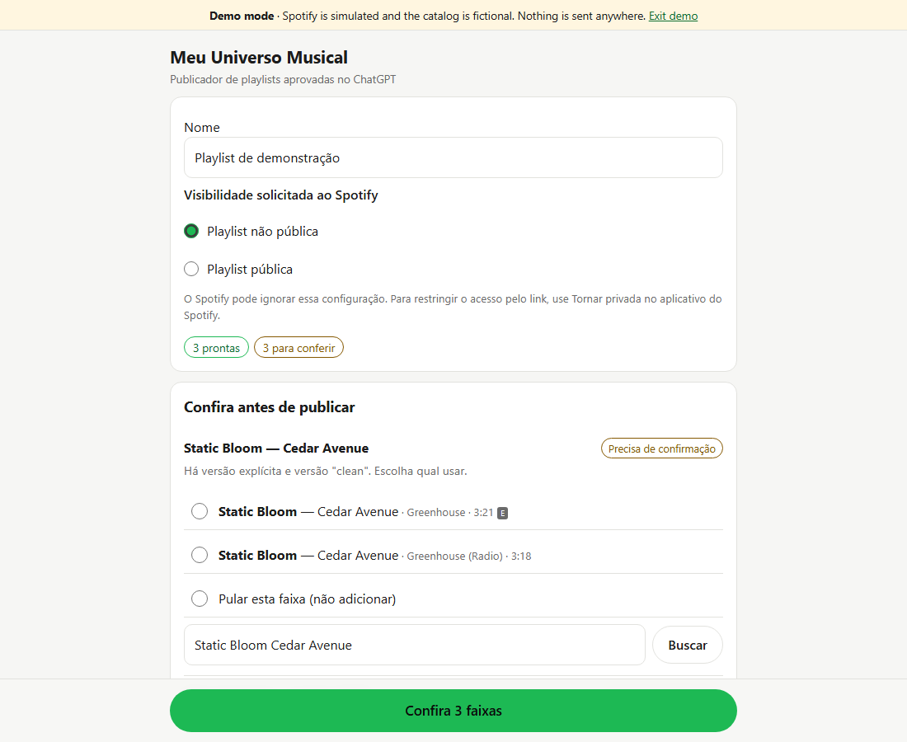

# Playlist Publisher

[](https://github.com/ericrc77/playlist-creator/actions/workflows/ci.yml)

A web app that turns an approved track list (JSON) into a Spotify playlist. It looks up every track, asks you to
decide only the doubtful ones, and publishes through the official API without creating duplicates when something
fails halfway.

**[Try the demo](https://playlist-creator-ruby.vercel.app/demo)** · no Spotify account needed



> The interface is in Brazilian Portuguese. Demo mode uses a simulated Spotify and a fictional catalog.

## The problem

Copying a track list into Spotify by hand is slow, and automatic importers tend to pick the wrong version
(live, remix, clean edit) without saying so. Retrying after a network error often creates a second playlist.

## What it does

- Validates the JSON against a [versioned contract](docs/CONTRACT.md) and rejects files that carry credentials.
- Selects a track automatically only when title, artists and version agree. Everything else asks for a decision.
- Publishes idempotently: an interrupted run resumes where it stopped.
- Reads the playlist back to confirm tracks, order and visibility.
- Keeps you signed in without exposing the refresh token to page scripts.

## Architecture

```text
Browser (React)                          Vercel function                 Spotify
┌──────────────────────────┐   code +    ┌──────────────────────┐        ┌──────────┐
│ components  → hooks      │ verifier    │ /api/auth/*          │───────▶│ Accounts │
│ lib: contract, matching, │───────────▶ │ encrypted HttpOnly   │        └──────────┘
│      publish, spotify    │ access token│ session cookie       │
│                          │◀─────────── └──────────────────────┘        ┌──────────┐
│                          │────────────────── Web API calls ───────────▶│ Web API  │
└──────────────────────────┘                                             └──────────┘
```

| Path | Responsibility |
|------|----------------|
| `src/components` | Presentation |
| `src/features/playlist` | Review and publishing state |
| `src/lib` | Contract, matching, publishing, OAuth and API client (no React) |
| `src/demo` | In-memory Spotify used by `/demo` |
| `server`, `api` | Token exchange, refresh and logout |

The reasoning behind the main choices is in [docs/ARCHITECTURE.md](docs/ARCHITECTURE.md).

## Run locally

Requirements: Node.js 22.13+ and, for real publishing, a Spotify app.

```bash
npm ci
npm run dev
```

Open <http://127.0.0.1:5173/demo> to use the demo with no configuration.

### Connecting a real Spotify account

1. In the [Spotify Developer Dashboard](https://developer.spotify.com/dashboard), create an app with **Web API**.
2. Add the redirect URI `http://127.0.0.1:5173/callback` (Spotify does not accept `localhost`).
3. Add your account under **User Management**.
4. `cp .env.example .env.local` and set `VITE_SPOTIFY_CLIENT_ID`. No client secret is used.

Spotify limits apps in Development Mode: the owner needs Premium and only a few registered users can sign in (see the
[February 2026 migration guide](https://developer.spotify.com/documentation/web-api/tutorials/february-2026-migration-guide)).
That is why the public demo is simulated.

### Deploying

Import the repository in Vercel (`vercel.json` already defines the build, rewrites and security headers) and set:

| Variable | Secret | Purpose |
|----------|--------|---------|
| `VITE_SPOTIFY_CLIENT_ID` | no | Spotify app identifier, embedded at build time |
| `SESSION_SECRET` | **yes** | Encrypts the session cookie; at least 32 characters |

Generate the secret with `node -e "console.log(require('crypto').randomBytes(32).toString('hex'))"`, then register
`https://<your-domain>/callback` in Spotify. Check your hosting plan's terms before any commercial use.

## Quality

```bash
npm run check   # lint, type check, tests and production build
```

The test suite covers the contract, matching rules, OAuth session handling, resumable publishing, concurrency
between actions, the demo flow and the serverless function running on plain Node ESM.

## Security

- No secrets in the repository or in the browser bundle.
- Refresh token in an `HttpOnly`, `Secure`, `SameSite=Strict` cookie encrypted with AES-256-GCM; the access token
  lives in memory.
- Auth routes accept only same-origin `POST` requests with a custom header, and the server fixes `redirect_uri`.
- Restrictive Content Security Policy.

## Limitations

- "Not public" is a request: Spotify may ignore it, and anyone with the link can still open a non-public playlist.
- The interface is available only in Portuguese.
- Publishing jobs are stored in the browser, so a resume must happen on the same device.

## License

[MIT](LICENSE). Not affiliated with or endorsed by Spotify.
